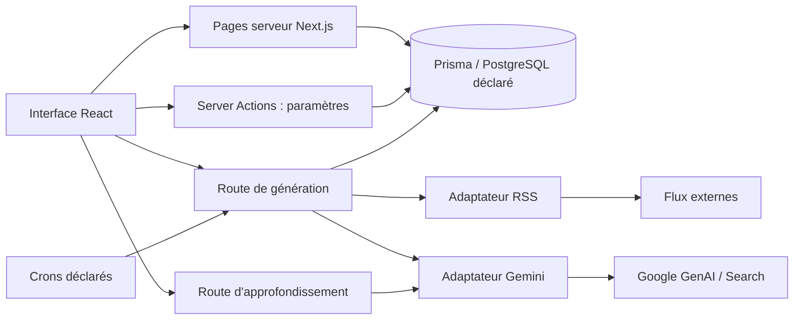

# Fiche d'application — Veyl

> Format : `application-profile/1.0` · Fiche : `0.1` · Audit : **15 octobre 2026**.
> Statut : **état des lieux + cible proposée, non validée**.
> Révision : `1205e3d`, branche `codex/application-profile` ; documentation locale non commitée incluse.
> Famille : **web-contenu**, consultation de veille avec génération IA.
> Référentiel comparé : [socle commun proposé 0.1](common-foundation.md).

Veyl est le pilote du format de fiche. Son existant sert à éprouver la grille ; les choix actuels ne deviennent pas automatiquement des standards pour les autres applications. Aucune migration n'est engagée par ce document.

## 1. Finalité et contraintes

| Champ | Situation |
|---|---|
| Identifiant stable | `veyl` ; paquet npm nommé `veille-techno` |
| Utilité observée | Collecter des actualités RSS et produire des synthèses IA, Luxembourg et Tech. Consulter l'historique et approfondir une actualité à la demande. |
| Usage déclaré | Personnel, desktop/mobile selon `AGENTS.md` ; exposition et appareils réellement utilisés **INCONNUS** |
| Parcours essentiels | Lire une synthèse par date/catégorie ; générer la veille ; approfondir ; gérer sources et prompts |
| Supports observés | Application web responsive dans le code ; installation PWA et fonctionnement hors ligne non établis |
| Connexion | Base et services réseau utilisés côté serveur ; aucune stratégie hors ligne observée |
| Données persistantes | Synthèses, sources, prompts, activation du cron ; criticité, sensibilité et durée de conservation à confirmer |
| Dépendances externes | Flux RSS, Google GenAI ; Google Search pour l'approfondissement |
| Exploitation | Configuration de crons Vercel présente ; hébergement actif, coûts, quotas, volumétrie, sauvegardes et disponibilité **INCONNUS** |

## 2. Méthode et niveau de preuve

**OBSERVÉ** = code/configuration lus ; **EXÉCUTÉ** = commande réellement lancée ; **DÉCLARÉ** = documentation ; **INCONNU** = non établi ; **PROPOSÉ** = cible future.

Audit statique des sources `src/`, schéma et migrations Prisma, manifests, scripts de diagnostic et configurations. Deux analyses distinctes sont conservées dans les rapports [architecture](audits/architecture-audit.md) et [qualité](audits/quality-audit.md).

Aucun accès à une base, appel RSS/Gemini, seed, migration ou déploiement. Aucune valeur de secret consultée. Aucun parcours navigateur vérifié : les constats de design décrivent l'implémentation, pas son rendu validé. Les contrôles effectivement lancés sont indiqués en section 6.

## 3. Stack effective

Les déclarations viennent de `package.json`. Les 23 dépendances directes installées correspondent au lockfile dans ce workspace ; une dépendance installée n'établit pas la version en production. Environnement du contrôle : **Node 24.19.0 / npm 11.17.0**, sans version fixée par le projet.

| Élément | Existant observé / déclaré | Source |
|---|---|---|
| Runtime / paquets | Écosystème Node.js, npm, `package-lock.json` ; reproductibilité à contrôler | `package.json`, lockfile |
| Framework | Next.js `^16.3.6`, App Router ; pages dynamiques serveur et composants client | `package.json:19`, `src/app/page.tsx:7` |
| UI | React/React DOM `19.0.0-rc-66855b96-20241106` ; types React `^18` | `package.json:22` |
| Langage | TypeScript `^5`, `strict: true`, alias `@/*` | `tsconfig.json:11` |
| Style / composants | Tailwind `^3.4.1`, plugin Typography, Lucide, `next-themes`, composants locaux ; Shadcn non établi dans les sources inspectées | `tailwind.config.ts:3`, `src/components/` |
| Contenu | `react-markdown ^10.1.0`, `date-fns ^4.4.0`, locale française | `package.json`, `src/components/ClientHome.tsx:6` |
| Données | Prisma/client `^5.22.0` ; schéma courant **PostgreSQL** | `prisma/schema.prisma:1` |
| Intégrations | `@google/genai ^2.24.0`, `rss-parser ^3.13.0` et `fetch` serveur | `src/lib/gemini.ts:1`, `src/lib/rss.ts:1` |
| Validation | Pas de dépendance Zod ni validation de schéma dans les entrées inspectées | `package.json`, actions et API |
| Tests | Aucun runner unitaire/E2E configuré dans le périmètre inspecté ; scripts diagnostic isolés | Section 6 |
| Planification | `vercel.json` déclare IA/Tech en semaine et Luxembourg le vendredi, expression à 03:00 ; fuseau effectif non vérifié | `vercel.json:2` |

| Paquet | Verrouillé et installé lors de l'audit |
|---|---|
| Next / React / React DOM | `16.3.6` / `19.0.0-rc-66855b96-20241106` / même RC |
| TypeScript / types React / types React DOM | `5.9.3` / `18.3.31` / `18.3.7` |
| Prisma et client | `5.22.0` |
| Tailwind / Typography | `3.4.19` / `0.5.20` |
| ESLint / eslint-config-next | `8.57.1` / `15.0.3` (déclaré `latest`) |
| Google GenAI / rss-parser | `2.24.0` / `3.13.0` |

**Cohérence des dépendances :** le calcul semver local confirme que la RC React installée ne satisfait pas le peer React déclaré par Next installé. `.npmrc` utilise `legacy-peer-deps=true`. Les types React 18 et la configuration ESLint Next 15 ajoutent des décalages de générations. Cela constitue un écart de reproductibilité ; aucun bug UI précis n'en est déduit.

**Contradictions documentaires :** `AGENTS.md:10` annonce Next.js 15, SQLite, Shadcn et sombre par défaut ; les sources indiquent Next.js 16 déclaré, PostgreSQL, composants locaux et thème système. Le README est encore celui de démarrage Next.js. Les polices locales Geist sont présentes, mais le layout importe Inter et le CSS global déclare Arial : police effectivement rendue non vérifiée.

## 4. Architecture et flux

Monolithe Next.js : `src/app` porte routes, pages et actions ; `src/components` le rendu et l'état temporaire ; `src/lib` les intégrations. Les pages/actions/routes appellent directement Prisma. Les règles de génération, les requêtes et l'orchestration sont réunies dans le handler cron ; aucune couche repository/métier indépendante observée dans ce périmètre.

| Parcours | Fonctionnement observé | Limites et reprise |
|---|---|---|
| Lecture | Tous les digests triés, regroupés par jour côté serveur ; plus récent par catégorie/jour envoyé au client | Pas de pagination ; fuseau implicite ; erreurs de lecture sans état spécifique dans la page |
| Génération | Bouton appelant trois GET en parallèle ; chaque route lit réglages/sources, collecte RSS, filtre par dernière synthèse, appelle Gemini et insère un digest | Pas de clé d'idempotence ni verrou explicite ; plusieurs générations du même jour restent possibles ; l'UI ne distingue pas « aucun article » et création |
| Approfondissement | POST du texte vers Gemini avec Google Search ; résultat en état React, affichage repliable | Résultat perdu au rechargement ; erreur affichée ; nouvelle tentative possible ; pas de persistance observée |
| Paramètres | Actions serveur pour prompts, ajout, pause et suppression des sources ; invalidation de la page | Dépend de `Settings.default` ; `update` suppose sa présence ; pas de feedback dédié pour attente/succès/erreur |

Règles métier présentes : coupure sur la dernière génération, sinon deux jours pour IA/Tech et huit pour Luxembourg ; sources actives uniquement ; entrée Gemini tronquée à 100 000 caractères ; cinq modèles candidats, jusqu'à trois tentatives chacun. La disponibilité des modèles et leurs coûts ne sont pas vérifiés. Les erreurs RSS deviennent une liste vide, ce qui confond absence d'article et échec de source.

## 5. Données, sécurité et exploitation

| Sujet | Situation observée | Écart / inconnu |
|---|---|---|
| `Digest` | CUID, catégorie, titre, contenu, date ; pas de relation avec Source | Pas de provenance structurée, unicité de génération ou index métier explicite |
| `Source` | CUID, nom, URL unique, catégorie, activation | Catégorie libre ; même URL impossible dans plusieurs catégories |
| `Settings` | Trois prompts, `cronEnabled`, identifiant par défaut `default` | Singleton par convention du code ; autres identifiants non interdits |
| Schéma / migrations | Schéma PostgreSQL ; verrou et unique migration historiques SQLite, migration sans `geminiPromptTech` | Historique non aligné ; état et migrations de la base active inconnus |
| Accès | Pas de contrôle explicite d'identité/autorisation dans les actions et handlers lus | Exposition et éventuelle protection externe à confirmer avant de juger le risque réel |
| Entrées | Casts de `FormData`, contrôle de présence de `text`, liste de slugs pour cron | Types, taille, URLs de fetch serveur et destinations non validés par un contrat complet |
| Configuration | Schéma utilisant `DATABASE_URL` et `DIRECT_URL` ; SDK IA instancié sans clé passée explicitement | Variables réellement provisionnées, rotation et hébergeur inconnus ; aucune valeur lue |
| Données / logs | Texte d'approfondissement journalisé ; messages techniques d'API renvoyés au client | Politique de logs/rétention et suppression des données à définir |
| Tolérance aux pannes | Replis et tentatives Gemini ; collecte des sources en parallèle | Pas de suivi durable des jobs, de budget global ou d'état partiel ; délai du `fetch` RSS non borné explicitement |
| Sauvegarde / export | Pas de procédure observée dans les fichiers inspectés | Existence d'une sauvegarde fournisseur, restauration testée et portabilité inconnues |
| Déploiement | Crons déclarés ; script build | Déploiement actif, alertes, historique de livraison et retour arrière non établis |

Le GET de génération produit des écritures et des appels IA. Sa protection et celle des paramètres constituent une question préalable si l'application est accessible sur Internet ; la configuration de cron ne constitue pas une preuve de contrôle d'accès.

## 6. Tests et contrôles de qualité

| Contrôle | État établi | Résultat |
|---|---|---|
| Typage | **EXÉCUTÉ** : `./node_modules/.bin/tsc --noEmit --incremental false`, sortie 2 | **FAIL** : propriété `eslint` inconnue dans `NextConfig` et module `prisma/config` introuvable |
| Lint | Script `next lint`, configuration ESLint présente ; commande absente du CLI Next installé, constat par lecture locale | NON EXÉCUTÉ ; incohérence de commande OBSERVÉE |
| Unitaires | Pas de script `test`, runner, assertions automatisées ou couverture configurés observés | ABSENT ; couverture INCONNUE |
| Intégration | Diagnostics `test-db.js`, `test-rss.js`, `test-models.js` et `test_markdown.js`, sans suite de non-régression | ABSENT comme suite ; diagnostics NON EXÉCUTÉS pour éviter accès externes/base |
| E2E / rechargement | Playwright annoncé dans AGENTS, absent de la configuration observée | ABSENT |
| Build | `npm run build` disponible ; configuration ignorant les erreurs TypeScript et ESLint | NON EXÉCUTÉ : audit documentaire, dépendances externes possibles ; aucun build vert revendiqué |
| Harness / CI | Harness externe annoncé et fichier présent sur cette machine ; ni config harness locale ni workflow CI identifiés dans le dépôt inspecté | NON EXÉCUTÉ ; reproductibilité non établie |
| Navigateur / responsive / accessibilité | Styles et comportements lus uniquement | NON EXÉCUTÉ : aucun verdict visuel ou fonctionnel |

**Un script nommé `test` n'est pas une preuve de tests.** Ici les diagnostics interrogent des fournisseurs ou affichent un résultat, sans contrat automatisé de réussite. Un build configuré pour ignorer les erreurs ne remplace pas les contrôles dédiés.

Le typecheck a été lancé sans cache incrémental et sans génération Next préalable ; il évalue le workspace présent, avec ses types générés déjà disponibles. Les deux erreurs sont reproduites intégralement dans le rapport qualité. Elles n'ont pas été corrigées dans cette tâche documentaire.

Contrat de tests **PROPOSÉ**, à implémenter lors d'un chantier distinct :

| Niveau | Scénario à protéger | Résultat attendu |
|---|---|---|
| Unitaire | Groupement par jour/catégorie, tri et fuseau décidé | Dernière synthèse de chaque catégorie conservée, aucune date perdue aux frontières de jour |
| Unitaire | Première collecte / dernière génération / dates RSS invalides | Fenêtre de collecte explicite, comportement déterministe, horloge simulée |
| Unitaire | Markdown : section, puce, lien seul, Sources | Texte correct à approfondir ; aucune action sur les éléments exclus |
| Unitaire | Erreurs, reprises et modèle de repli IA | Délais et nombre d'essais bornés ; arrêt après succès ; échec explicite, fournisseur simulé |
| Intégration | Validation, accès et erreurs des routes/actions | Entrée invalide rejetée ; acteur non autorisé refusé si protection requise ; aucun appel IA indu |
| Intégration | Source en doublon, settings absents, migration et création de digest | Contraintes testées sur base isolée ; résultat cohérent et erreur exploitable |
| E2E | Générer, choisir date/catégorie, recharger | Synthèse créée consultable après rechargement ; absence de nouveau contenu distinguée du succès |
| E2E | Ajouter, mettre en pause, supprimer une source ; modifier un prompt | Données conservées après rechargement ; attente, succès et erreur visibles |
| E2E | Approfondir, fermer/rouvrir, subir un échec puis réessayer | Cache de session cohérent ; erreurs récupérables ; aucune console inattendue |
| E2E / UX | Mobile/desktop, clavier, zoom, thème puis rechargement | Actions accessibles, navigation utilisable, préférence de thème respectée |

Outillage de départ suivant les conventions globales : Vitest pour le métier Next.js et Playwright pour les parcours web, avec fournisseurs simulés et base de test isolée. Versions et installation à décider et vérifier lors de ce chantier ; aucun test installé pour produire cette fiche.

## 7. Principes d'interface, hors direction artistique

| Dimension | Existant observé | Cible commune proposée / variante |
|---|---|---|
| Structure | En-tête fixe, historique latéral, onglets, panneau de lecture ; paramètres sur une page dédiée | Navigation stable et action principale identifiable ; structure adaptée au contenu |
| Lisibilité | Titres hiérarchisés, Markdown `prose`, taille adaptée avec `sm:` ; lecture `max-w-none` | Largeur de lecture maîtrisée et densité adaptée ; vérifier les longs contenus sur grand écran |
| Surfaces | Panneaux avec bordures, ombres légères, `rounded-lg/xl`, espacement Tailwind | Échelle et rôles sémantiques cohérents ; palette libre |
| Composants / tokens | Composants locaux ; classes visuelles répétées ; deux variables CSS de couleur | Tokens fond/surface/texte/bordure/action/états ; boutons, champs et retours réutilisables |
| Responsive | Historique accordéon sur mobile, latéral dès `md`, formulaires empilés puis en ligne | Conserver les actions sur les supports cibles ; contrôle navigateur restant à faire |
| Thème | `defaultTheme="system"`, clair/sombre via `next-themes`, bascule utilisateur | Variante système + choix ; vérifier persistance et contrôle en mode système |
| Accessibilité | Boutons natifs, certains `aria-label`, focus de champs ; zoom limité par viewport ; labels sans association explicite ; deux `main` imbriqués à l'accueil | Zoom autorisé, landmarks cohérents, labels, focus/clavier et contrastes testés ; sémantique des onglets à préciser |
| Langue / formats | HTML français, dates et ancienneté avec locale `fr` ; quelques réponses techniques anglaises | Messages français cohérents ; fuseau explicite pour regroupement/planification |
| Mouvement / feedback | Spinners et transitions ; erreurs d'approfondissement inline ; génération en `alert` | Attente et reprise homogènes, succès explicite, animations respectant les préférences |

| Parcours | Chargement | Vide | Erreur / reprise | Succès |
|---|---|---|---|---|
| Lecture | Pas d'état dédié de page observé | Messages en cas de synthèse ou d'historique absent | Pas d'état métier dédié pour erreur de lecture | Synthèse Markdown affichée |
| Génération | Bouton désactivé, spinner et texte | Réponse API « aucun article », sans restitution spécifique côté UI | `alert` global ; bouton de nouveau utilisable | Refresh ; pas de confirmation de création ou résultat partiel |
| Approfondissement | Spinner et texte | Pas de cas dédié pour réponse vide | Message inline ; nouvel appel possible | Carte repliable ; contenu en mémoire |
| Paramètres | Pas de retour d'attente dédié | `return null` si settings absents ; pas de message dédié si sources vides | Pas de message métier ni reprise dédiés | Revalidation, sans confirmation explicite |

Le style global proposé est **sobre, lisible, cohérent et adaptatif**. L'indigo, les dégradés, le logo et les accents par catégorie restent des choix de Veyl. L'uniformisation doit porter sur les principes et comportements décrits dans le [socle](common-foundation.md), pas sur ces éléments de marque.

## 8. Matrice de comparaison

Situation = présence observée face à la proposition 0.1, pas certification. **COMMUN** = exigence transversale ; **VARIANTE** = choix adapté à l'usage ; **MÉTIER** = spécifique à l'application. Preuves détaillées dans les sections indiquées et les rapports.

| ID | Critère | Périmètre | Valeur observée | Situation | Cible / preuve |
|---|---|---|---|---|---|
| DOC-01 | Documentation et commandes fiables | COMMUN | AGENTS/README divergents | PARTIEL | Documentation fidèle ; §3/6 |
| STK-01 | Famille de framework | VARIANTE | Next.js App Router | EN PLACE | Maintien proposé pour contenu serveur ; §3/4 |
| STK-02 | Dépendances et environnement reproductibles | COMMUN | Lockfile, versions/types hétérogènes | PARTIEL | Environnement et compatibilité vérifiés ; rapport qualité |
| ARC-01 | Séparation interface / métier / données | COMMUN | UI et intégrations séparées ; accès Prisma direct | PARTIEL | Métier testable + repositories ; §4 |
| DAT-01 | Stockage adapté à l'usage | VARIANTE | PostgreSQL dans le schéma ; usage d'exploitation non confirmé | INCONNU | Décider selon usage local/distant ; §1/5 |
| DAT-02 | Schéma unique et migrations cohérentes | COMMUN | Prisma unique, historique SQLite divergent | PARTIEL | Historique compatible et reconstruction isolée ; §5 |
| DAT-03 | Sauvegarde, restauration, portabilité | COMMUN | Procédure non observée ; fournisseur inconnu | INCONNU | Restauration et export prouvés ; §5 |
| SEC-01 | Validation des entrées externes | COMMUN | Contrôles ponctuels, casts | PARTIEL | Contrats complets aux frontières ; §5 |
| SEC-02 | Accès adaptés à l'exposition | COMMUN | Pas de garde explicite dans les handlers/actions | INCONNU | Établir exposition, protéger selon acteurs ; §5 |
| SEC-03 | Secrets et configuration | COMMUN | Adaptateur serveur, `.env*` ignorés | PARTIEL | Configuration exemple, logs/erreurs maîtrisés ; §5 |
| TST-01 | Typage strict et lint exécutables | COMMUN | Typecheck FAIL ; commande lint incohérente ; build permissif | PARTIEL | Gates dédiées bloquantes ; rapport qualité |
| TST-02 | Unitaires métier déterministes | COMMUN | Diagnostics sans suite unitaire | ABSENT | Contrat §6 |
| TST-03 | Intégration données et contrats | COMMUN | Pas de suite isolée observée | ABSENT | Contrat §6 |
| TST-04 | E2E et persistance | COMMUN | Playwright non configuré | ABSENT | Contrat §6 |
| TST-05 | Harness reproductible et preuve indépendante | COMMUN | Chemin personnel annoncé, pas de gate locale établie | ABSENT | Harness et QA applicative ; §6 |
| UX-01 | Tokens et composants cohérents | COMMUN | Tailwind, composants locaux, répétition | PARTIEL | Tokens sémantiques et primitives ; §7 |
| UX-02 | Chargement, vide, erreur, succès | COMMUN | Approfondissement équipé ; paramètres incomplets | PARTIEL | Quatre états sur chaque parcours ; §7 |
| UX-03 | Responsive et accessibilité | COMMUN | Styles responsive ; obstacles statiques repérés | PARTIEL | Vérification et corrections ciblées ; §7 |
| UX-04 | Thème et préférences | VARIANTE | Système, bascule clair/sombre | EN PLACE | Variante à conserver, comportement à tester ; §7 |
| UX-05 | Langue et formats | COMMUN | Français/date-fns fr ; fuseau implicite | PARTIEL | Langue et fuseau cohérents ; §7 |
| OPS-01 | Diagnostic, quotas et échecs | COMMUN | Console, retries ; erreurs RSS silencieuses côté utilisateur | PARTIEL | État des jobs, coûts, délais et reprise ; §4/5 |
| OPS-02 | Livraison et retour arrière | COMMUN | Build/crons déclarés ; CI/retour arrière non établis | INCONNU | Procédure et preuves ; §5/6 |
| BIZ-01 | Fonctionnalités spécifiques | MÉTIER | RSS, synthèses et approfondissement IA | EN PLACE | Conserver les parcours en migration ; §4/6 |

## 9. Trajectoire de convergence proposée

Ordre à confirmer après connaissance de l'exposition réelle. Aucun changement de framework ou de moteur de données recommandé sur la seule base d'une uniformisation.

| Ordre | Chantier | Acceptation mesurable | Données / retour arrière |
|---|---|---|---|
| 1 | Fiabiliser documentation et environnement ; identifier exposition, base active, sauvegardes et contraintes d'usage | Fiche/AGENTS/commandes cohérents, versions vérifiées, base identifiée, restauration de copie prouvée | Aucune migration initiale ; restaurer les documents/configs précédents |
| 2 | Protéger accès et entrées selon l'exposition ; maîtriser erreurs et logs | Refus des accès/entrées invalides ; aucun appel IA indu ; messages utiles | Préserver les contenus ; retour au code précédent avec stratégie d'accès maîtrisée |
| 3 | Rendre typage/lint bloquants et installer la protection de non-régression | Commandes vertes ; unitaires métier + intégration + E2E critiques déterministes, harness strict et QA indépendante | Base de tests isolée ; code en petits changements réversibles |
| 4 | Aligner historique de migrations et isoler accès aux données / métier | Copie restaurée, reconstruction et migration répétées sur environnement isolé ; contrats et parcours verts | Plan explicite de sauvegarde/retour testé ; aucune opération distante dans ce chantier documentaire |
| 5 | Formaliser tokens, composants, quatre états et accessibilité | Mobile/desktop, clavier/zoom et retours d'action vérifiés ; captures et E2E | Pas de migration de données ; retour par changement UI isolé |
| 6 | Fiabiliser génération et exploitation | Reprises bornées, résultat partiel explicite, politique de doublons définie, suivi des coûts/jobs | Toute évolution de schéma préparée et validée séparément |

Effort **INCONNU** avant cadrage des lots ; éviter un chiffrage trompeur sans contraintes d'exploitation. Les mesures de protection d'une exposition publique peuvent devenir prioritaires immédiatement.

## 10. Décisions et maintenance

| Décision | Statut | Motif |
|---|---|---|
| Veyl comme application pilote | DEMANDÉ par l'utilisateur, 15/10/2026 | Éprouver le format et préparer des comparaisons |
| Socle commun avec variantes | ORIENTATION DEMANDÉE | Industrialiser en tenant compte des besoins propres |
| Exigences détaillées du socle 0.1 | PROPOSÉ | À valider à partir du pilote et d'une deuxième application |
| Maintenir Next.js pour Veyl | PROPOSÉ | Architecture actuelle adaptée à la famille contenu ; aucun besoin contraire établi |
| Choisir définitivement stockage/hébergement, politique d'accès et fuseau | À DÉCIDER | Usage réel et environnement non confirmés |
| Migrer ou refondre l'application | NON ENGAGÉ | Demande actuelle documentaire |

Mettre à jour cette fiche en cas de changement de stack, schéma, exposition, parcours essentiel ou commande qualité. Garder les mêmes IDs de critères pour les autres apps et versionner la cible commune. Documenter les variantes acceptées avec motif, date et condition de réexamen.

## 11. Sources et limites

- [AGENTS.md](../AGENTS.md), [package.json](../package.json), [lockfile](../package-lock.json), [tsconfig](../tsconfig.json), [Next config](../next.config.ts), [Tailwind](../tailwind.config.ts).
- [Page d'accueil](../src/app/page.tsx), [ClientHome](../src/components/ClientHome.tsx), [approfondissement UI](../src/components/ExpandableNews.tsx), [layout](../src/app/layout.tsx), [CSS global](../src/app/globals.css), [thème](../src/components/theme-toggle.tsx), [paramètres](../src/app/settings/page.tsx).
- [Actions](../src/app/settings/actions.ts), [cron](../src/app/api/cron/%5Bcategory%5D/route.ts), [approfondissement API](../src/app/api/go-further/route.ts), [RSS](../src/lib/rss.ts), [Gemini](../src/lib/gemini.ts).
- [Schéma](../prisma/schema.prisma), [migration](../prisma/migrations/20260922081028_init/migration.sql), [verrou migrations](../prisma/migrations/migration_lock.toml), [crons](../vercel.json).
- Rapports [architecture](audits/architecture-audit.md) et [qualité](audits/quality-audit.md) : références par ligne et contrôles.

L'état de production, les données existantes, les protections d'hébergement, la santé des fournisseurs et le rendu réel restent à vérifier avant une migration. Cette fiche n'est pas un verdict QA de l'application.
